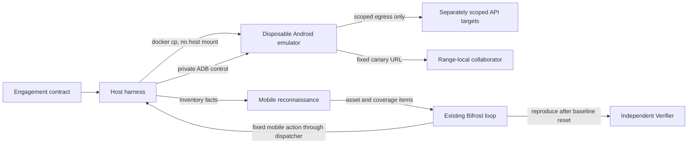

# HC-MOB-01 - Android mobile runtime pentesting

## Purpose

This spec defines the first runnable mobile-app path through Capri.
It adds an Android runtime target to the existing isolated engagement, agent loop, technique cards, evidence, and verification flow.

## User contract

An engagement may declare an operator-supplied Android APK.
Capri runs the APK in a disposable emulator and treats the APK as untrusted target code.
The APK's backend APIs are separate assets and must be authorized in the same engagement scope before existing web techniques can reach them.
Source is optional and improves discovery without becoming a prerequisite for a black-box APK run.

This first slice makes only `KB-MOBILE-LINK-DEEPLINK-001` runnable.
It inventories manifest-declared Android components and deep-link filters, invokes applicable deep links with a range-local canary, and requires deterministic evidence plus reproduction by the independent Verifier before a finding is confirmed.
Coverage reports what the manifest exposed and what Capri attempted; it does not claim to cover every screen or business workflow in the app.

## Runtime boundary

The Android emulator is an additional member of the existing private Docker range, not a separate model or orchestration plane.
Its emulator image and Android API level are pinned.
ADB is available only over the internal range control path and no emulator or ADB port is published on a host interface.

Native Android runtime testing requires a Linux host with KVM.
Windows Docker Desktop continues to support existing non-mobile engagements, but mobile active testing fails closed if Linux/KVM or emulator readiness is missing.

The APK is copied into the attacker container, inspected there, and installed into the emulator through ADB without a host directory mount.
The package path and source path are not sent to model roles or included in reports.
The range records the package identity and APK digest for auditability.

## System design

The feature adds one managed Android emulator container to the existing Docker range.
The host-side harness owns APK transfer, emulator lifecycle, ADB calls, scope policy, and evidence collection.
The Operator and Verifier see only a mobile asset identifier and the manifest-derived deep link being tested.
They cannot select ADB subcommands, package paths, callback hosts, or arbitrary shell arguments.

## Packages and versions

The harness uses Python 3.12 standard-library modules for contract handling, hashing, subprocess I/O, JSON, and XML parsing.
No new Python runtime dependency is introduced.

The emulator uses Google's Android Emulator Container Scripts image `us-docker.pkg.dev/android-emulator-268719/images/30-google-x64-no-metrics:30.1.2`, pinned by digest `sha256:e78ac1816acef59e40285e90003acd490ef54bb3242ed088afa31bc982577050`.
The `no-metrics` image variant avoids emulator usage telemetry.
The API 30 image is the currently published Google container image selected for this first slice; the image digest, API level, and tested APK compatibility are recorded with the run.

APK inspection uses Google's Android SDK Command-line Tools build `15859902`, checksum-pinned to `4e4c464f145a7512b57d088ac6c278c03c9eea610886b35a5e0804e74eedf583`.
The `apkanalyzer manifest print` command provides decoded manifest XML, and Python's `xml.etree.ElementTree` reads the package, permissions, components, exported state, and intent filters.
ADB uses Google's Android SDK Platform-Tools `37.0.1`, checksum-pinned to `d230f13842f60f782a8645f9c813f8f845bf36089ea7289f28c48f17979313f1`.
Docker Engine is the only host-side runtime dependency; the existing pinned nftables guard image continues to install network policy.

The canary source targets Android API 30 and builds with Android SDK Platform `android-30`, Build-Tools `30.0.3`, and JDK 17.
It adds no runtime dependency to the harness or attacker image.

## Inventory and probe algorithms

APK validation rejects a non-file, a ZIP without `AndroidManifest.xml`, an analyzer error, malformed XML, or a manifest without a valid package name.
The host computes SHA-256 before transfer and uses `docker cp` without mounting the APK's containing directory.

Manifest inventory walks each activity, activity-alias, service, receiver, and provider in document order.
It normalizes relative component names against the package, records explicit `android:exported` values, declared permissions, and intent filters with `VIEW` plus `BROWSABLE` and data scheme/host/path constraints.
Each supported deep-link filter becomes a stable asset keyed by package, component, and filter index.
URL launch probes use Android's `am start` with the fixed `VIEW` action, `BROWSABLE` category, and a harness-selected URL under the range-local collaborator.
The app's callback is accepted only when the collaborator log contains both the unpredictable per-probe nonce and the emulator's expected source address.

## Runtime flow

1. Parse and validate the APK declaration and ordinary network scope.
2. Require a Linux Docker host with KVM, verify the pinned emulator image is available, and create the existing internal range.
3. Start the emulator with no published ports, install the guest egress guard, and prove boot, private ADB, blocked internet/DNS, blocked out-of-scope egress, and allowed scoped API connectivity.
4. Copy the APK into the managed range, install it, inventory the manifest, and add mobile assets to the recon model.
5. Record package identity, APK digest, emulator digest, and inventory counts in the append-only audit log.
6. Run only the deep-link technique card through normal Planner, Operator, Dispatcher, blast, rate, audit, evidence, and coverage gates.
7. For verification, clear app data and re-run the exact fixed reproduction step with a verifier-owned nonce.
8. Confirm only when the collaborator observes that nonce from the emulator's pinned range address; otherwise retain attempted or inconclusive coverage.
9. Kill or teardown stops both emulator and other range containers and removes temporary APK copies and run state.

## Canary validation

`tests/fixtures/mobile/canary/` contains one minimal app with vulnerable and patched manifest configurations.
The vulnerable variant fetches an arbitrary HTTP or HTTPS URL from the deep-link `url` parameter; the patched variant accepts only HTTPS to `api.capri.test`.
Both variants expose the same `capri://open/fetch` link, so the same deterministic probe should confirm only the vulnerable variant.

Install SDK Platform `android-30` and Build-Tools `30.0.3` with `sdkmanager`, then run `bash tools/build_mobile_canaries.sh` with JDK 17 on a Linux host.
For example, `sdkmanager "platforms;android-30" "build-tools;30.0.3"` installs the pinned SDK packages after the operator accepts their Android SDK licenses.
The script writes signed APKs to the ignored `build/mobile-canary/` directory; generated APKs are not committed.
Set `HC_ENGAGEMENT_CONTRACT` to an APK-only contract for each generated APK and run `python3 tools/run_engagement.py` separately for vulnerable and patched variants.
The vulnerable run must confirm `KB-MOBILE-LINK-DEEPLINK-001`; the patched run must produce no confirmed finding while recording the deep-link check as attempted.
Both runs must pass the emulator egress proofs and independent Verifier flow.
The live check requires Linux Docker with KVM and the existing Bifrost model-plane configuration.

## Dependency and package policy

The Google emulator image is pulled by immutable digest and never by `latest`.
The SDK Command-line Tools archive is downloaded during the attacker image build only after its SHA-256 matches the pinned value.
The ADB keypair is generated inside the attacker container for one run; only its public key is passed to the emulator container.
The private ADB key and the operator's local APK path are not sent to model roles, reports, or ordinary logs.
The user-supplied APK is treated as hostile and is parsed and executed only inside range containers.

## Run configuration

Build the attacker image with the pinned Android SDK tools using `docker build -t hc-attacker:golden -f infra/sandbox/Dockerfile.attacker infra/sandbox`.
Pull the emulator by digest before the run using the image reference above.
Set `HC_ENGAGEMENT_CONTRACT` to a local YAML contract whose `engagement.android_app.apk` points to the operator's APK, then run `python tools/run_engagement.py` on a Linux Docker host with KVM.
For an APK-only assessment, `scope: {}` is valid; any backend API hosts still need ordinary explicit scope declarations.

## Authorization and egress

The APK is treated as hostile code.
The emulator guest has no route to the public internet, the operator host, or out-of-scope hosts.
Its egress is limited to explicitly scoped API targets and the range-local collaborator on the ports needed for the engagement.
ADB control traffic is separately limited to the managed emulator and is not a model-selectable arbitrary shell.

The range must prove the emulator is booted, the ADB control path is private, and the Android guest cannot reach an internet canary before the loop leaves passive-only mode.
A failed or incomplete proof prevents active mobile probes and reports mobile coverage as not run with a reason.
The existing scope guard, blast-tier gate, rate limits, audit log, and kill switch remain authoritative.

## Reconnaissance and coverage

Mobile reconnaissance reads the APK manifest using pinned Android tooling and records the package, declared components, exported state, permissions, and deep-link filters as untrusted recon facts.
The source tree, when supplied, may enrich the inventory but cannot authorize a target or expand network scope.

The deep-link capability is applicable only when recon found a declared link filter.
Each link filter is represented as a coverage item so attempted, not-applicable, and not-run results remain distinguishable.
An APK with no supported deep links is not reported as clean for other mobile attack surfaces.

The probe adapter invokes links through the managed emulator control path.
The deep-link card's fixed action and callback destination are harness-controlled; the callback terminates at the in-range collaborator.
Only the collaborator's matching run nonce is a success signal.
Reflection, model text, a successful activity launch, or an HTTP status alone cannot confirm the finding.

## Agent and finding flow

The existing Planner, Operator, Dispatcher, Verifier, evidence store, coverage ledger, and report validator are reused.
The model may propose an allowed mobile probe but cannot choose an arbitrary ADB command or callback destination.
Every adapter action passes the existing dispatch gates and produces the usual immutable probe event and audit entry.

The Verifier receives only the recorded reproduction step and runs it against a clean emulator state restored from the engagement baseline.
The Verifier remains on the disjoint provider selected by the existing Bifrost model-plane configuration.
The deterministic harness signal, rather than either model's narrative, decides whether the finding is confirmed.

## Implementation slices

1. Add the pinned Android emulator to the private range, with Linux/KVM readiness, private ADB control, egress enforcement, proof coverage, kill, and teardown.
2. Accept the APK artifact, install it without a host mount, and create manifest-derived mobile coverage items.
3. Make the deep-link card runnable through the existing dispatcher and confirm findings through the existing independent Verifier and report.

## Test decisions

Public behavior is tested through the engagement contract, the injected Docker and ADB command runners, decoded APK manifest fixtures, and the normal dispatch-to-report flow.
The normal test suite does not require KVM; it verifies fail-closed behavior when the device or control path is unavailable and validates the canary manifests.
A Linux/KVM live run with both generated APKs is the release gate for canary validation.

The callback must be absent from a controlled deep link and present only for the vulnerable fixture route.
Missing KVM, emulator boot failure, ADB failure, malformed APK, and absent deep links must produce explicit errors or coverage statuses rather than a clean result.

## Out of scope

- iOS and physical-device assessment.
- Making the other nine HC-KB-11 cards runnable.
- Automated discovery of every screen, business workflow, or API contract.
- Runtime hooking, repackaging, anti-tampering bypass, biometrics, and keystore extraction.
- Changes to Bifrost, providers, model roles, or existing web adapter behavior.
- Active Android emulator execution on Windows Docker Desktop.

## Implementation pointer

Mobile-specific APK, emulator lifecycle, egress policy, protocol, capability, contract, and recon behavior lives in `harness/mobile/`.
The shared Docker range and engagement loop call the mobile package at integration points, while retaining web behavior in their existing modules.
The runtime integration is in `harness/sandbox/docker.py`, `harness/dispatch.py`, `harness/loop.py`, `harness/roleio.py`, `harness/substrate/contract.py`, and `tools/run_engagement.py`.
Package build pins live in `infra/sandbox/Dockerfile.attacker`.
`tests/test_mobile.py` covers manifest inventory, contract and scope authorization, deep-link construction, dispatch through independent verification, egress policy, and unsupported-host behavior.
Canary source and a pinned-toolchain build script live in `tests/fixtures/mobile/canary/` and `tools/build_mobile_canaries.sh`.
The generated APKs and live Linux/KVM results are not yet available from this Windows host.
